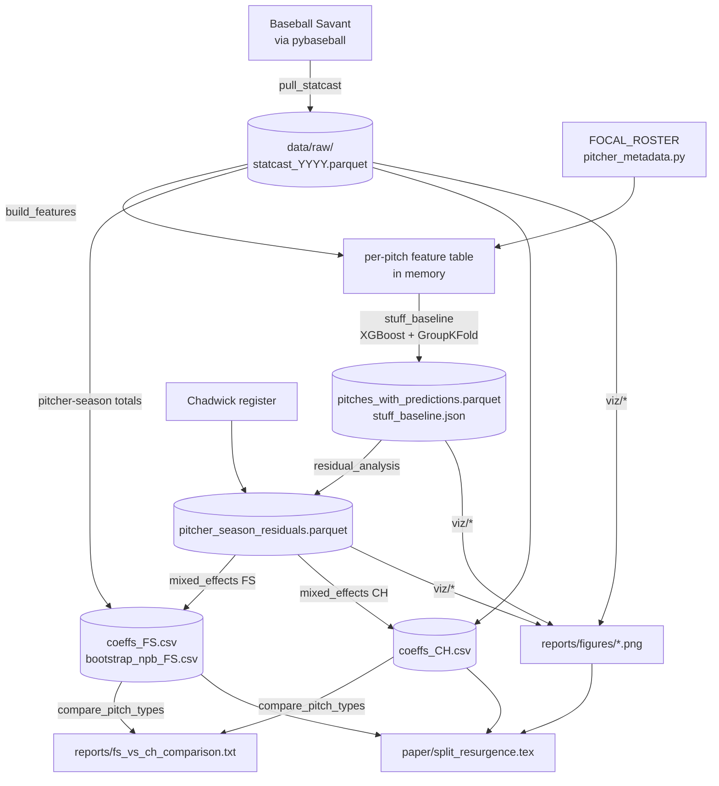

# Split-Resurgence — Design Document

| | |
|---|---|
| **Status** | v1 complete (data, modeling, figures, paper) |
| **Owner** | Kylan Huynh |
| **Paper** | [`paper/split_resurgence.pdf`](../paper/split_resurgence.pdf) |
| **Last updated** | 2026-10-11 |

This document explains how the Split-Resurgence pipeline is built and why. The
paper reports what the pipeline found. This document covers the stages, the
data contracts between them, the decisions behind each stage, and the known
weak points. The module docstrings in `src/` cover implementation detail.

---

## 1. Problem

Dave Roberts told Jeff Passan in 2025 that "the analytics hasn't caught up to
the split." The project turns that into a testable question:

> What physical and contextual features of a splitter predict its resistance to
> pitch-grading models, and does NPB development add explanatory power once
> those features are controlled for?

"Resistance to pitch-grading models" is made concrete as **model resistance**:
how much better (or worse) a pitcher's splitter performed than a physics-only
run-value model predicted.

### Goals

1. Fit a run-value model that sees only the physical characteristics of each pitch.
2. Measure, per pitcher-season, the gap between actual and predicted run value.
3. Regress that gap on development and usage features with honest uncertainty
   on the NPB term, which rests on only five pitchers.
4. Repeat on changeups to separate splitter-specific effects from general
   off-speed effects.
5. Produce figures and a paper that anyone with `uv` can reproduce from a clean clone.

### Non-goals

- **Injury risk.** This needs UCL data the project doesn't have and doesn't
  bear on the pitch-grading question.
- **Hitter cognition** (Roberts' third claim). This needs bat-tracking or
  biometric data. It is deferred to v2.
- **NPB-side pitch data.** NPB Tracker / DELTA quality would dominate the error budget.
- **Causal claims.** The design is associational. Posting-system selection bias
  among NPB pitchers can't be fixed with available data.

---

## 2. Architecture

The pipeline is a linear chain of `python -m` entry points. Each stage reads
the previous stage's artifact from `data/` and writes its own. No stage holds
state in memory across runs, so any stage can be rerun alone once its inputs
exist.



### Repository layout

```
src/
├── data/
│   ├── pull_statcast.py        # Stage 1: league-wide Statcast pulls, monthly chunks
│   ├── pitcher_metadata.py     # Focal roster + primary-fastball baseline
│   ├── build_features.py       # Stage 2: per-pitch feature table
│   └── aggregate.py            # Pitcher-season descriptive aggregates
├── analysis/
│   └── splinker_subcluster.py  # GMM: traditional splitter vs splinker
├── models/
│   ├── stuff_baseline.py       # Stage 3: physics-only XGBoost, out-of-fold predictions
│   ├── residual_analysis.py    # Stage 4: residuals → model_resistance + metadata
│   ├── mixed_effects.py        # Stage 5: MixedLM + cluster bootstrap
│   └── compare_pitch_types.py  # Stage 6: FS vs CH side by side
├── viz/                        # Stage 7: three paper figures + shared style
└── run_smoke.py                # One-week end-to-end check of the data layer
docs/design.md                  # This document
paper/                          # LaTeX source + compiled PDF
reports/                        # Text outputs, figures, original markdown draft
data/{raw,interim,processed}/   # Caches and derived outputs (see §4)
```

---

## 3. Stages

### Stage 1: Pull (`src/data/pull_statcast.py`)

- **Input:** Baseball Savant through `pybaseball.statcast()`.
- **Output:** `data/raw/statcast_{season}.parquet` for 2021–2025, plus per-month
  chunk files.
- **Scope:** Regular season plus postseason. The windows are hard-coded in
  `SEASON_WINDOWS`. Spring training is excluded.

**Decisions**

| Decision | Why | Alternative rejected |
|---|---|---|
| Pull league-wide, not per pitcher | The baseline needs the full distribution of fastballs and changeups, and the regression needs every FS pitcher with 100+ pitches, not just the focal ten. | Per-pitcher pulls would bias the baseline toward the focal pitchers. |
| Chunk by month, cache every chunk | Savant sometimes returns a malformed CSV. One bad day shouldn't lose a season, and a crashed pull should resume quickly. | A single season call fails often and restarts from zero. |
| Retry with linear backoff (3 attempts) | The failures are transient parser and HTTP errors. | — |
| Drop rows with null `pitch_type` at pull time | They can't be assigned to any analysis and only inflate the cache. | — |

### Stage 2: Features (`src/data/build_features.py`, `pitcher_metadata.py`)

- **Input:** Concatenated raw seasons.
- **Output:** A per-pitch frame with the Statcast columns in `KEEP_COLS` plus
  engineered features.

**Engineered features**

| Feature | Definition |
|---|---|
| `velo_diff_vs_fastball` | `release_speed` − mean velocity of the pitcher-season's primary fastball |
| `ivb_diff_vs_fastball` | `pfx_z` − primary-fastball mean `pfx_z` (in **feet**, as Statcast stores it) |
| `is_two_strike`, `is_three_ball`, `same_handed` | Count and matchup flags |
| `prev_pitch_type` | Lag-1 pitch type within the plate appearance, built for sequencing work and **not used in v1** |

**Decisions**

- **Primary fastball = the most-thrown of {FF, SI, FC} that pitcher-season.** A
  splitter's tunneling partner depends on the pitcher: Gausman pairs it with a
  four-seamer, sinker-first pitchers with a sinker. A fixed FF reference would
  misstate the differential for a large share of pitchers.
- **Fastball baseline and lag features are computed before filtering** to the
  analysis pitch types, so the "previous pitch" is the real previous pitch.
- **The 100-pitch minimum is applied later, at aggregation**, so the feature
  table can also feed league-wide distribution plots.

### Stage 3: Physics-only baseline (`src/models/stuff_baseline.py`)

- **Input:** The Stage 2 table for FS, CH, FF, SI and FC.
- **Output:**
  - `pitches_with_predictions.parquet`: 472,650 FS and CH pitches with
    out-of-fold `pred_run_value` and `residual`. This file is about 54 MB and
    gitignored.
  - `stuff_baseline.json`: the full-data XGBoost model.
- **Target:** `delta_run_exp`, Statcast's base-out-aware per-pitch run value.

**Features:** velocity; `pfx_x`/`pfx_z`; release x/z and extension; the
`vx0, vy0, vz0, ax, ay, az` trajectory terms; spin axis and rate; plate x/z;
balls and strikes; the two fastball differentials; and categorical `pitch_type`,
`stand` and `p_throws`.

**Decisions**

| Decision | Why | Alternative rejected |
|---|---|---|
| **Exclude pitcher and batter identity** | The residual is meant to measure what physics doesn't explain. Identity features would absorb exactly that signal. | — |
| **One unified model with `pitch_type` as a categorical** | The model learns one run-value surface, so a splitter and a changeup with identical physics get the same prediction. That is the comparison the FS-vs-CH test needs. | Separate per-type models would each normalize to their own mean and erase between-type gaps. |
| **GroupKFold (5 folds) on (pitcher, season)** | Every prediction comes from a model that never saw that pitcher-season, which blocks memorization through near-duplicate pitches. | Random KFold leaks within-pitcher information and shrinks residuals. |
| **Deliberately modest hyperparameters** (400 trees, depth 6, lr 0.05, subsample 0.7, colsample 0.8, min_child_weight 20) | The residuals are the dependent variable downstream. An over-fit baseline leaves only noise in them. | Tuning for minimum RMSE. |
| **XGBoost `hist` with native categoricals** | Fast on about 3M rows and needs no one-hot encoding. | LightGBM would have worked equally well. The choice is not load-bearing. |

**Quality bar:** out-of-fold RMSE 0.224 and mean residual ≈ 0. Per-pitch run
value is dominated by noise, so the bar is an unbiased model, not a low RMSE.

### Stage 4: Residual aggregation (`src/models/residual_analysis.py`)

- **Input:** Predictions parquet, focal roster, Chadwick register.
- **Output:** `pitcher_season_residuals.parquet` at the grain
  (pitcher, season, pitch_type), with at least 100 pitches per row. It has
  1,405 rows: 239 FS and 1,166 CH.

**Key definitions**

```
model_resistance  = −100 × mean(actual − predicted)   # RV/100, + = beat the model
run_value_per_100 = −100 × mean(delta_run_exp)        # RV/100, + = good for pitcher
mlb_seasons_in    = game_year − debut_year
is_novelty_year   = (mlb_seasons_in == 0)
npb_years         = roster value for focal NPB pitchers, else 0
left_censored     = non-focal pitcher whose debut predates 2021
```

**Decisions**

- **Sign-flip both measures** so higher always means better for the pitcher,
  matching public run-value leaderboards.
- **Debut year comes from the hand-curated roster first, then Chadwick.** The
  roster is authoritative for the ten focal pitchers. Ohtani's two-way history
  confuses automated lookups, for example. Chadwick results are cached to
  `pitcher_debuts.csv` because the lookup is slow.
- **Every pitcher gets `npb_years`**, set to 0 for non-NPB pitchers. The
  controls then have hundreds of pitcher-seasons of support, not just the focal ten.

### Stage 5: Mixed-effects regression (`src/models/mixed_effects.py`)

```
model_resistance ~ npb_years + mlb_seasons_in + fastball_velo_mean
                   + usage_share + is_novelty_year + (1 | pitcher)
```

- **Fit:** `statsmodels` MixedLM with REML and a random pitcher intercept.
- **`usage_share`:** the pitch type's share of **all** pitches the pitcher threw
  that season. The denominator comes from the raw caches and is persisted as
  `pitcher_season_totals.csv` so fresh clones don't need the raw data (see §6.1).
- **Predictors with no variation are dropped automatically.** In practice this
  is `npb_years` on CH.

**Decisions**

| Decision | Why |
|---|---|
| **Random pitcher intercept** | Seasons from the same pitcher aren't independent. The intercept variance is also a finding: it measures pitcher-specific signal that physics misses. |
| **Optimizer fallback (lbfgs → bfgs → cg → powell)** | Many pitchers have exactly one qualifying season, which makes the random-effect Hessian near-singular. L-BFGS fails with `LinAlgError` on the FS data and BFGS converges. |
| **Cluster bootstrap on `npb_years` only** (2,000 pitcher resamples, duplicates re-keyed as distinct groups, NaN when a resample has no NPB rows) | The asymptotic SE treats 8 NPB rows as independent information, but they come from 5 pitchers. The other coefficients have hundreds of supporting rows, so asymptotics are fine for them. |
| **Fixed seed (`default_rng(0)`)** | The bootstrap interval reproduces exactly. |

### Stage 6: FS vs CH comparison (`src/models/compare_pitch_types.py`)

This stage reads both coefficient CSVs and writes a side-by-side text report. It
fits nothing.

### Stage 7: Figures (`src/viz/`)

| Figure | Module | Shows |
|---|---|---|
| 1 | `residuals_plot.py` | FS pitcher-seasons: run value vs model resistance, focal pitchers labeled |
| 2 | `tunnel_plot.py` | Release point and plate location, FB vs FS, for Yamamoto, Gausman and Skenes |
| 3 | `case_studies.py` | Season-by-season model resistance and handedness splits for the same three |

All figures use `viz/style.py`. It is a color-blind-safe Wong palette with
vermillion for NPB, blue for domestic and grey for the league pool. It avoids
default seaborn styling and exports PNGs at 200 dpi.

### Side analysis: splinker sub-clustering (`src/analysis/splinker_subcluster.py`)

The Statcast FS tag bundles traditional splitters (~86 mph) with splinkers such
as Skenes' 94 mph pitch. A two-component GMM on standardized
(`velo_mean`, `velo_diff_mean`) at the pitcher-season grain separates them, and
labels are reordered by mean velocity so they stay stable across runs. The two
centroids are traditional ≈ 85.7 mph with a −9.8 mph gap and splinker ≈ 87.5 mph
with a −5.9 mph gap. **The v1 regression does not use the clusters** (see §6.3).

---

## 4. Artifacts and what's committed

| Path | Size | Committed? | Regenerate with |
|---|---|---|---|
| `data/raw/statcast_*.parquet` | ~480 MB | No | `pull_statcast --all` (~30 min, network-bound) |
| `data/processed/pitches_with_predictions.parquet` | ~54 MB | No | `stuff_baseline` (~10 min) |
| `data/processed/stuff_baseline.json` | 2.8 MB | Yes | `stuff_baseline` |
| `data/processed/pitcher_season_residuals.parquet` | 0.2 MB | Yes | `residual_analysis` |
| `data/processed/pitcher_season_totals.csv` | small | Yes | `mixed_effects` (needs raw caches on the first run) |
| `data/processed/mixed_effects_coeffs_{FS,CH}.csv` | small | Yes | `mixed_effects` |
| `data/processed/bootstrap_npb_coefficient_FS.csv` | small | Yes | `mixed_effects --bootstrap 2000` (~30 min) |
| `data/processed/pitcher_roster.csv`, `pitcher_debuts.csv` | small | Yes | `resolve_roster()`, `residual_analysis` |
| `reports/figures/*.png` | 1.9 MB | Yes | `viz/*` |
| `paper/split_resurgence.pdf` | — | Yes | `tectonic paper/split_resurgence.tex` |

The rule: commit anything small enough to diff or review that the paper depends
on. Regenerate anything large that only depends on public data.

---

## 5. Running it

```sh
uv sync --extra modeling
uv run python -m src.run_smoke                                  # ~30 s sanity check
uv run python -m src.data.pull_statcast --all                   # ~30 min
uv run python -m src.models.stuff_baseline                      # ~10 min
uv run python -m src.models.residual_analysis
uv run python -m src.models.mixed_effects --pitch-type FS --bootstrap 2000   # ~30 min
uv run python -m src.models.mixed_effects --pitch-type CH
uv run python -m src.models.compare_pitch_types
uv run python -m src.viz.residuals_plot
uv run python -m src.viz.tunnel_plot
uv run python -m src.viz.case_studies
tectonic paper/split_resurgence.tex                             # builds the PDF
```

Use `--bootstrap 50` for a quick iteration loop. Only the reported numbers need 2,000.

**Testing.** The only automated check is `run_smoke`. It runs one week of data
through pull → features → aggregate → cluster → roster resolution. The modeling
stages have no unit tests. Their checks are the logged RMSE and bias, the
convergence count, and the Walker 2024 sanity check described in the paper.

---

## 6. Known issues and decisions to revisit

### 6.1 `usage_share` denominator (fixed 2026-10-11)

The original `mixed_effects.py` computed `usage_share` as FS ÷ (FS + CH) because
the residuals table had no all-pitch total. That made `usage_share = 1` for 90%
of FS rows and 97% of CH rows. The variable was really a flag for "doesn't also
throw the other off-speed pitch," but the draft writeup interpreted it as share
of the arsenal. It now uses all pitches as the denominator, matching
`aggregate.py`. The effect on the results:

| | FS old | FS fixed | CH old | CH fixed |
|---|---|---|---|---|
| `usage_share` | +2.80 (p=.043) | **+3.15 (p=.002)** | +1.46 (p=.125) | **+2.34 (p<.001)** |
| `is_novelty_year` | −0.66 (p=.093) | **−0.87 (p=.027)** | −0.16 (p=.375) | −0.13 (p=.464) |
| group variance | 0.40 | 0.35 | 0.17 | 0.14 |
| `npb_years` | +0.101 | +0.101 | dropped | dropped |
| `npb_years` bootstrap 95% CI | [−0.07, +0.21] | [−0.11, +0.25] | — | — |

The draft's claim that the splitter rewards specialization about twice as much
as the changeup no longer holds. Both pitch types reward usage, and the
intervals overlap. The paper has been updated.

### 6.2 Features built but not used

`prev_pitch_type`, `is_two_strike`, `is_three_ball` and `same_handed` are
computed but not fed to the baseline. Sequencing is the clearest route to
Roberts' "slow fastball" claim and the first candidate for v2.

### 6.3 FS sub-clusters are not stratified

The regression pools traditional splitters and splinkers. A stratified rerun
is about a day of work and decides whether the pooling hides real heterogeneity.

### 6.4 `run_value_per_100` and `model_resistance` share a target

Both come from `delta_run_exp`, so Figure 1's diagonal trend is partly
mechanical. The figure shows where NPB pitchers sit, not a relationship to
interpret.

### 6.5 Single-season NPB rows

Eight NPB rows come from five pitchers. Sasaki contributes one 271-pitch
season. The NPB conclusion is "underpowered," not "absent," and the
cheapest fix is more seasons.

### 6.6 Units

`pfx_z` and `ivb_diff_vs_fastball` are in feet. Multiply by 12 for the inches
used in public pitch-design writing.

---

## 7. v2 roadmap

Ordered by value per unit of effort:

1. **Arm-slot split for Yamamoto.** Cluster his 2024–25 release points and
   compute model resistance per cluster. About half a day.
2. **Stratify FS by sub-cluster** and rerun Stage 5.
3. **Third comparison pitch** (curveball or sweeper) to test whether the usage
   effect is general off-speed behavior.
4. **Bootstrap the variance components** to put an interval on the 2.4× FS/CH
   pitcher-variance ratio.
5. **Within-season Skenes decomposition** to tell gradual hitter adaptation
   from a step change.
6. **Bayesian hierarchical refit** (PyMC or brms) with a weakly informative
   prior on `npb_years`.
7. **Add the 2026 season** to grow the NPB sample.
8. **Bat-tracking features** for the hitter-cognition claim.
